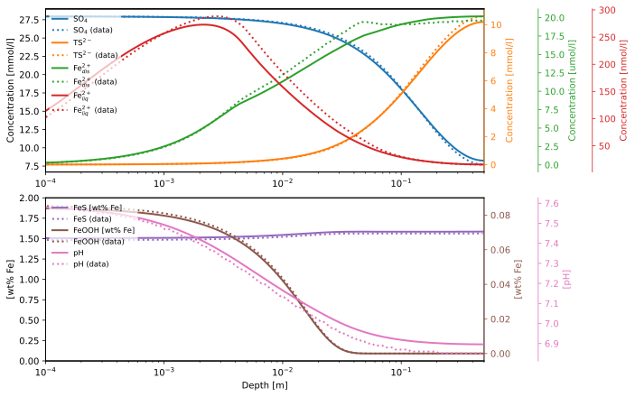
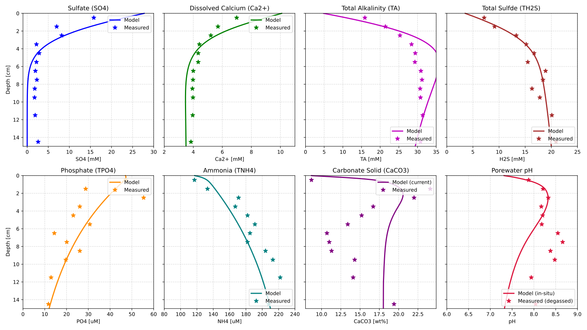

# Examples

Mantis comes with several example models. To install the example models, execute `mantis_create_examples.py` which will create the examples directory in your current working directory.

## Start here

This directory contains a bare-bones example with the main objective to be a simple as possible to demonstrate the Mantis structure and setup.

## Velde et al. 2016 Iron and Sulfur cycling

The `no_isotopes` directory contains various models that are based on the Velde et al. 2016 paper &ldquo;The Influence of Bioturbation on Iron and Sulphur Cycling in Marine Sediments: A Model Analysis&rdquo; <http://dx.doi.org/10.1007/s10498-016-9301-7>. Their paper describes a model with a huge gamut of reaction rates, steep spatial gradients, and extremely rapid iron-mono-sulfide precipitation. The Mantis results show small differences to the original solution that are likely a function of the different strategies in the respective solver backends.

.")

The remaining sub-directories contain derived models that demonstrate several extensions, i.e., how to add irrigation, isotope effects, and carbonate system equations.

## Du 2023, Iron Speciation

This model shows the Mantis implementation of the iron-speciation model described by Du 2023, &ldquo;Sedtrace 1.0: a Julia-Based Framework for Generating and Running Reactive-Transport Models of Marine Sediment Diagenesis Specializing in Trace Elements and Isotopes&rdquo; <http://dx.doi.org/10.5194/gmd-16-5865-2023>. This model shows how to implement pH-sensitive reactions without adding the full carbonate system. The Mantis solution shows minor differences in the pH values that are likely related to the fact that Mantis calculates pH as a function of total alkalinity(TA) and dissolved inorganic carbon (DIC), rather than adding $\ce{H+}$ and the associated carbonate dissociation products to the transport matrix. Since speciation is a function of pH, the resulting species concentrations differ as well

## Chromatographic Isotope Fractionation

Note: As of Nov. 21st 2026, this section and the below example are AI generated and have not yet been reviewed.

The `chromatographic_fractionation` directory demonstrates chromatographic isotope separation during 1D advective-dispersive transport with equilibrium solid-liquid sorption. It models the invasion of dissolved ferrous iron ($\ce{Fe^2+}$, $C_{\text{top}} = 1.0\text{ mmol/L}$, $\delta^{56}\text{Fe} = 0.0\text{ mUr}$ relative to IRMM-014) into a 20 cm iron-free sediment column ($\phi = 0.8$, downward porewater advection $u = 5.0\text{ cm/yr}$, $T = 10^\circ\text{C}$, $t = 0.5\text{ yr}$) undergoing linear equilibrium sorption ($\ce{Fe^2+_{liq} <-> Fe^2+_{sorbed}}$, $f_{\text{dis}} = 0.5$) with an equilibrium fractionation factor $\alpha_{\text{eq}} = 0.998$ for the light companion $\ce{^{54}Fe}$ (corresponding to preferential sorption of $\ce{^{56}Fe}$). Mantis computes the companion dissolved fraction as $f_{\text{dis,54}} = f_{\text{dis}} / (f_{\text{dis}} + \alpha_{\text{eq}}(1 - f_{\text{dis}})) \approx 0.5005 > f_{\text{dis}}$, giving $\ce{^{54}Fe}$ lower retardation ($R_{54} < R_{\text{bulk}}$) in both advection and molecular diffusion. Consequently, $\ce{^{54}Fe}$ outpaces $\ce{^{56}Fe}$ along the invading front: the front midpoint ($C_{\text{total}} = 0.5\text{ mmol/L}$) advances to $z = 5.55\text{ cm}$, a constant equilibrium offset ($\delta^{56}\text{Fe}_{\text{liq}} \approx -1.07\text{ mUr}$, $\delta^{56}\text{Fe}_{\text{sorbed}} \approx +1.06\text{ mUr}$ near $z = 0$) is maintained between phases, and $\delta^{56}\text{Fe}_{\text{total}}$ drops progressively to $-4.28\text{ mUr}$ ($\delta^{56}\text{Fe}_{\text{liq}} = -5.34\text{ mUr}$) toward the leading edge ($z = 19.95\text{ cm}$), agreeing within 0.16% (concentrations) and 0.36%&ndash;0.59% ($\delta^{56}\text{Fe}$) with the analytical Ogata-Banks retarded advection-dispersion solution.

 against the analytical Ogata-Banks retarded advection-dispersion solution (dotted lines) after 0.5 yr. Top: Total, dissolved, and sorbed $\ce{Fe^2+}$ concentration profiles across the 20 cm column. Bottom: $\delta^{56}\text{Fe}$ (mUr IRMM-014) of total, dissolved, and sorbed iron, showing the constant equilibrium offset between dissolved and sorbed phases and the progressive negative chromatographic excursion toward the leading edge of the invading front.")

## Luff  and Wallmann 2003   Carbonate Precipitation

This directory contains the Mantis implementation of the carbonate dissolution/precipitation model by Luff and Wallman 2003, &ldquo;Fluid Flow, Methane Fluxes, Carbonate Precipitation and Biogeochemical Turnover in Gas Hydrate-Bearing Sediments At Hydrate Ridge, Cascadia Margin: Numerical Modeling and Mass Balances&rdquo;, <http://dx.doi.org/10.1016/S0016-7037(03)00127-3>. Implementing this model proved difficult, as Luff et al. did not publish data tables with their model results. Further, their results represent a transient stage, rather than a steady state solution. We thus plotted the Mantis results against the measured interstitial water data as published by Luff and Wallmann. Visual comparison with Fig 2 in Luff and Wallman suggests, however, a good match for the $\ce{Ca^2+}$, $\ce{NH_4^+}$ , $\ce{PO4}$, and $\ce{SO4^2-}$ concentration profiles.

