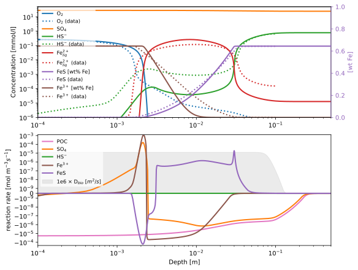
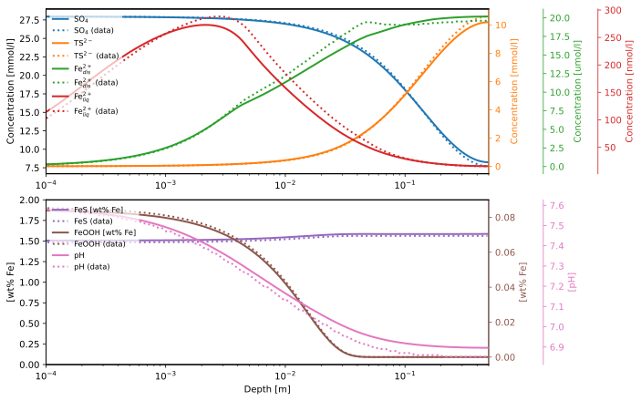
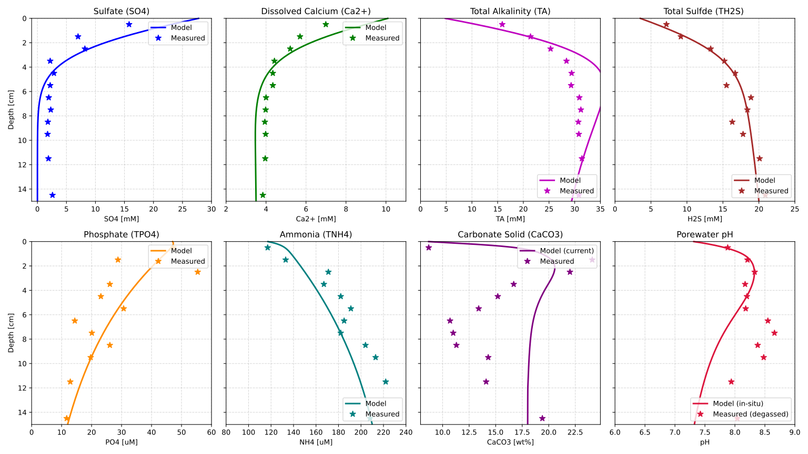

#+TITLE: Mantis Quick Start Tutorial: 2
#+AUTHOR:Ulrich G. Wortmann
#+STARTUP: showall shrink inlineimages
#+OPTIONS: todo:nil tasks:nil tags:nil toc:nil
#+EXCLUDE_TAGS: noexport answer
#+latex_compiler: lualatex
#+LATEX_CLASS: koma-article
#+latex_class_options: [11pt,letter]
#+latex_header: \newlength\bibitemsep
#+latex_header: \hypersetup{colorlinks=true,linkcolor=Navy,filecolor=Navy,urlcolor=Navy,citecolor=Navy,anchorcolor=Navy}

* Examples 
Mantis comes with several example models. To install the example models, execute  ~mantis_create_examples.py~ which will create the examples directory in your current working directory. 
** Start here 
This directory contains a bare-bones example with the main objective to be a simple as possible to demonstrate the Mantis structure and setup. 
**  Velde et al. 2016 Iron and Sulfur cycling 
The ~no_isotopes~ directory contains various models that are based on the Velde et al. 2016 paper "The Influence of Bioturbation on Iron and Sulphur Cycling in Marine Sediments: A Model Analysis" http://dx.doi.org/10.1007/s10498-016-9301-7. Their paper describes a model with a huge gamut of reaction rates, steep spatial gradients, and extremely rapid iron-mono-sulfide precipitation. The Mantis results show small differences to the original solution that are likely a function of the different strategies in the respective solver backends. 

#+attr_org: :width 400
#+attr_rst: :width 800
#+attr_md: :width 800
#+attr_latex: :width textwidth
#+name: velde 
#+caption: Comparison of the original Velde et al. 2016 model results with the mantis implementation.  The small differences to the original solution that likely a function of the different strategies in the respective solver backends. The original Velde concentration data was kindly supplied by C. Velde (pers. comm. 2026).

The remaining sub-directories contain derived models that demonstrate several extensions, i.e., how to add irrigation, isotope effects, and carbonate system equations. 

** Du 2023, Iron Speciation 
This model shows the Mantis implementation of the iron-speciation model described by Du 2023,  "Sedtrace 1.0: a Julia-Based Framework for Generating and Running Reactive-Transport Models of Marine Sediment Diagenesis Specializing in Trace Elements and Isotopes" http://dx.doi.org/10.5194/gmd-16-5865-2023. This model shows how to implement pH-sensitive reactions without adding the full carbonate system. The Mantis solution shows minor differences in the pH values that are likely related to the fact that Mantis calculates pH as a function of total alkalinity(TA) and dissolved inorganic carbon (DIC), rather than adding $\ce{H+}$ and the associated carbonate dissociation products to the transport matrix. Since speciation is a function of pH, the resulting species concentrations differ as well 
#+attr_org: :width 400
#+attr_rst: :width 400
#+attr_md: :width 400
#+attr_latex: :width 0.5\textwidth
#+name: simplefe
#+caption: Comparison of the Du 2023 iron speciation model results with the Mantis implementation.  Mantis does not explicitly model $\ce{H+}$ and the various carbon species. Rather it uses total alkalinity and dissolved inorganic carbon as state variables and derives pH as a function of TA and DIC. This results in small differences to the $\ce{H+}$ concentration and thus to the concentrations of the pH dependend iron species. 

** Luff  and Wallmann 2003   Carbonate Precipitation 
This directory contains the Mantis implementation of the carbonate dissolution/precipitation model by Luff and Wallman 2003, "Fluid Flow, Methane Fluxes, Carbonate Precipitation and Biogeochemical Turnover in Gas Hydrate-Bearing Sediments At Hydrate Ridge, Cascadia Margin: Numerical Modeling and Mass Balances",  http://dx.doi.org/10.1016/S0016-7037(03)00127-3. Implementing this model proved difficult, as Luff et al. did not publish data tables with their model results. Further, their results  represent a transient stage, rather than a steady state solution. We thus plotted the Mantis results against the measured interstitial water data as published by Luff and Wallmann. Visual comparison with Fig 2 in Luff and Wallman suggests, however, a good match for the $\ce{Ca^2+}$, $\ce{NH_4^+}$ , $\ce{PO4}$, and $\ce{SO4^2-}$ concentration profiles.   
#+attr_org: :width 400
#+attr_rst: :width 800
#+attr_md: :width 800
#+attr_latex: :width \textwidth
#+name: luff
#+caption: Comparison of the interstitial water data reported by Luff and Wallmann 2003, and the Mantis results. Visual comparison with Fig. 2 in  Luff and Wallmann 2003 suggests that the Mantis matches the original modeled data quite well. Note that the interstitial water data is not in equilibrium and that the model represents an transient stage. See discussion in Luff and Wallmann 2003.

